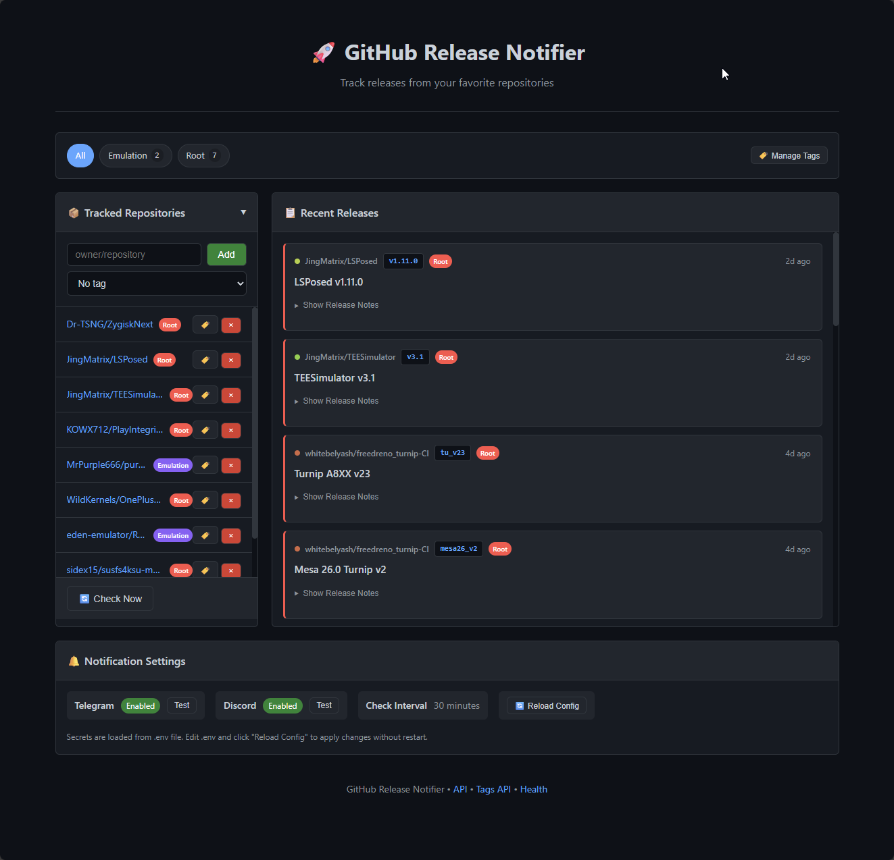
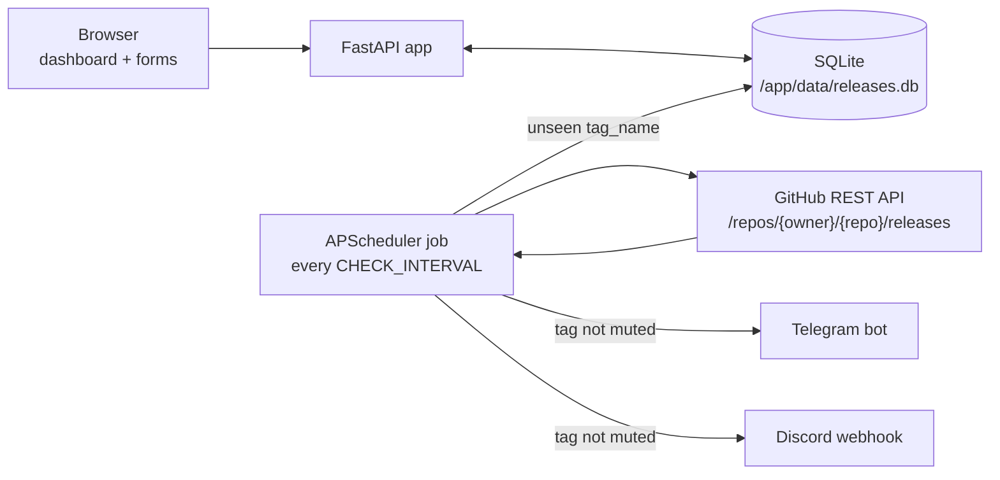

# GitHub Release Notifier

Self-hosted dashboard that watches GitHub repositories for new releases and
notifies you on Telegram and/or Discord. Small enough to run on a Raspberry Pi.

[](https://github.com/xD33m/gh-release-notifier/actions/workflows/ci.yml)
[](LICENSE)
[](https://github.com/xD33m/gh-release-notifier/pkgs/container/gh-release-notifier)



## Why it exists

Following releases through GitHub's notification inbox mixes them with
everything else. This app keeps one list of repositories, polls their releases
on a schedule, shows them on one page and pushes a message to the chat apps you
already have on your phone.

## Features

- **Track any GitHub repository** by `owner/repo`, from the web UI (validated
  against the GitHub API) or from `config.yaml`.
- **Telegram and Discord notifications**: a Markdown message via a Telegram bot
  and/or a rich embed via a Discord webhook, with test buttons in the UI.
- **No flood on first add**: releases that already exist when a repository is
  added are stored as already notified; only releases published afterwards are
  announced.
- **Release dashboard** with the 50 most recent releases and expandable,
  Markdown-rendered release notes.
- **Tags / categories** with colours: filter the dashboard and the API by tag
  and mute notifications per tag.
- **Manual "check now"** and hot reload of the `.env` secrets from the UI.
- **JSON API** for releases, repositories and tags.
- **Multi-arch Docker image** (`linux/amd64`, `linux/arm64`) published to GHCR,
  with a container healthcheck on `/health`.

## Quick start (Docker Compose)

In an empty directory, fetch the example configuration:

```bash
curl -fsSLO https://raw.githubusercontent.com/xD33m/gh-release-notifier/main/config.yaml
curl -fsSL -o .env https://raw.githubusercontent.com/xD33m/gh-release-notifier/main/.env.example
```

Edit `.env` (tokens, see [Configuration](#configuration)) and replace the
`repositories:` list in `config.yaml` with the repositories you want to follow
(or leave it empty and add them in the UI). Then create `compose.yaml`:

```yaml
services:
  release-notifier:
    image: ghcr.io/xd33m/gh-release-notifier:latest
    restart: unless-stopped
    ports:
      - "8000:8000"
    env_file:
      - .env
    volumes:
      - ./data:/app/data                          # SQLite database
      - ./config.yaml:/app/config/config.yaml:ro  # repositories and settings
      - ./.env:/app/.env:ro                       # re-read by "reload config"
```

```bash
docker compose up -d
```

The dashboard is available at `http://localhost:8000`. Use the test buttons in
the *Notification Settings* panel to check your Telegram and Discord setup.

The [`docker-compose.yml`](docker-compose.yml) in this repository is the
author's own deployment: it builds from source and publishes the app through
Traefik (external `web` network, basic-auth middleware) instead of a port.

## Configuration

### Environment variables (`.env`)

| Variable              | Required | Description                                       |
| --------------------- | -------- | ------------------------------------------------- |
| `GITHUB_TOKEN`        | No       | GitHub token, raises the API rate limit           |
| `CHECK_INTERVAL`      | No       | Minutes between checks (default: 30)              |
| `TELEGRAM_BOT_TOKEN`  | No\*     | Telegram bot token from @BotFather                |
| `TELEGRAM_CHAT_ID`    | No\*     | Your Telegram chat/group ID                       |
| `DISCORD_WEBHOOK_URL` | No\*     | Discord webhook URL                               |

\*Configure at least one notification channel. Telegram is enabled once both
the token and the chat ID are set; Discord once the webhook URL is set.

### `config.yaml`

| Key                                 | Description                                                 |
| ----------------------------------- | ----------------------------------------------------------- |
| `check_interval`                    | Minutes between checks (overridden by `CHECK_INTERVAL`)      |
| `notifications.telegram.enabled`    | Set to `false` to switch Telegram off even if configured     |
| `notifications.discord.enabled`     | Set to `false` to switch Discord off even if configured      |
| `repositories`                      | `owner/repo` entries that are added on every start           |

Secrets belong in `.env`; environment variables override values from
`config.yaml`.

### Getting notification credentials

**Telegram:** message [@BotFather](https://t.me/BotFather) and create a bot,
copy the bot token, get your chat ID from [@userinfobot](https://t.me/userinfobot),
then start a conversation with your bot.

**Discord:** *Server Settings → Integrations → Webhooks → New Webhook*, then
copy the webhook URL.

**GitHub token (optional, recommended):** create a token under
[GitHub Settings → Tokens](https://github.com/settings/tokens). Public
repositories need no extra scopes.

## How it works



One process runs both the FastAPI web app and an APScheduler background job. On
start-up it creates the SQLite schema, adds the repositories from `config.yaml`
and stores their current releases as already notified. Each scheduled check
fetches the five most recent releases of every tracked repository; a release is
new when its `(repository, tag_name)` pair is not in the database yet. New
releases are stored, announced on every enabled channel unless the repository's
tag is muted, and marked as notified.

| Module                    | Responsibility                                     |
| ------------------------- | -------------------------------------------------- |
| `app/main.py`             | FastAPI routes: dashboard, forms, JSON API, health |
| `app/scheduler.py`        | Start-up sync and the periodic release check       |
| `app/github_client.py`    | GitHub REST API calls via `httpx`                  |
| `app/database.py`         | SQLite schema and queries (`aiosqlite`)            |
| `app/config.py`           | `config.yaml` + environment, hot reload            |
| `app/notifications/`      | Telegram and Discord senders                       |

### API endpoints

| Endpoint                           | Method | Description                          |
| ---------------------------------- | ------ | ------------------------------------ |
| `/`                                | GET    | Web dashboard (`?tag=<id>` filter)   |
| `/api/releases`                    | GET    | Recent releases (JSON)               |
| `/api/repos`                       | GET    | Tracked repositories (JSON)          |
| `/api/tags`                        | GET    | Tags with repository counts (JSON)   |
| `/repos/add`, `/repos/remove`      | POST   | Add / remove a repository            |
| `/repos/set-tag`                   | POST   | Assign a tag to a repository         |
| `/tags/add`, `/tags/{id}/update`, `/tags/{id}/delete` | POST | Manage tags         |
| `/tags/{id}/toggle-notifications`  | POST   | Mute / unmute a tag                  |
| `/check-now`                       | POST   | Trigger an immediate check           |
| `/test/telegram`, `/test/discord`  | POST   | Send a test notification             |
| `/api/reload-config`               | POST   | Re-read `.env` and `config.yaml`     |
| `/api/debug-config`                | GET    | Which notification settings are loaded |
| `/health`                          | GET    | Health check                         |

## Trade-offs and limitations

- **No built-in authentication.** Every endpoint, including adding repositories,
  sending test messages and `/api/debug-config` (which shows the Telegram chat
  ID and the first characters of the bot token), is open. Run it on a trusted
  network or behind a reverse proxy with authentication, as the author does with
  Traefik.
- **Polling, not webhooks.** You cannot receive webhooks for other people's
  repositories, so the app polls: one request per repository per check,
  sequentially with a one-second pause. Without `GITHUB_TOKEN` GitHub allows 60
  requests per hour, i.e. roughly 30 repositories at the default 30-minute
  interval; with a token the limit is 5,000 per hour.
- **Only the five newest releases are checked.** If a repository publishes more
  than five releases between two checks, the older ones are never seen.
  Pre-releases are treated like any other release.
- **Fire-and-forget delivery.** A release is marked as notified even if the
  Telegram or Discord request failed; errors are only logged.
- **`config.yaml` repositories come back.** Entries in `repositories:` are
  re-added on every start, so remove them from the file, not just the UI.
- **Interval changes need a restart.** "Reload config" refreshes secrets and
  channel settings, but the scheduler keeps the interval it started with.
- **Untrusted Markdown.** Release notes are rendered in the browser with
  `marked` (loaded from jsDelivr) without sanitisation, so only track
  repositories you trust.
- **Default config in the image.** The image contains this repository's
  `config.yaml` as a fallback; mount your own at `/app/config/config.yaml`.

## Development

```bash
python -m venv .venv
source .venv/bin/activate        # .venv\Scripts\activate on Windows
pip install -r requirements-dev.txt
cp .env.example .env

ruff check .                     # lint
pytest                           # tests
uvicorn app.main:app --reload    # run locally on http://localhost:8000
```

The database path is fixed to `/app/data/releases.db`, so a local run creates
that directory. The tests use a temporary database, a fixed configuration and
fake GitHub/Telegram/Discord calls, so they need no network or credentials.

CI runs lint and tests on every push and pull request, then builds the
multi-arch image. Pushes to `main` publish `latest`, `main` and a commit-SHA tag
to `ghcr.io/xd33m/gh-release-notifier`; `v*` tags publish semver tags.

## How this was built

This project was built with AI coding assistants; the `memory-bank/` folder and
`.github/copilot-instructions.md` are the context files used by the agent. The
author reviewed and tested the code and runs it on his own server; the test
suite and CI pipeline were added afterwards.

## License

[MIT](LICENSE)
